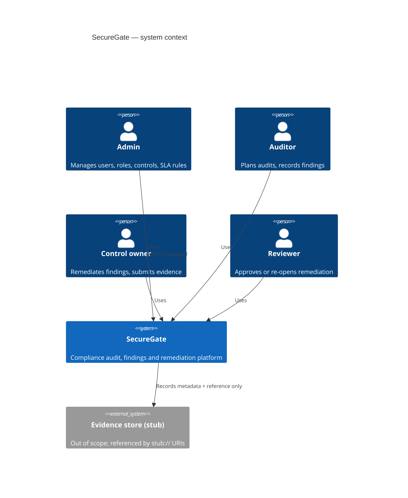
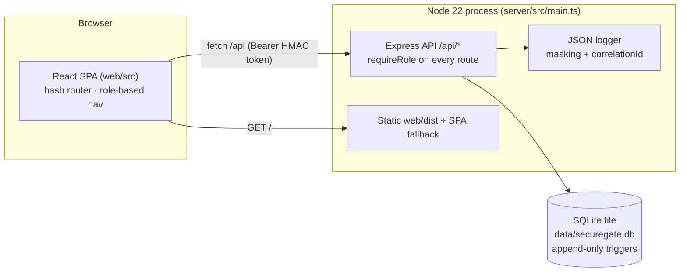
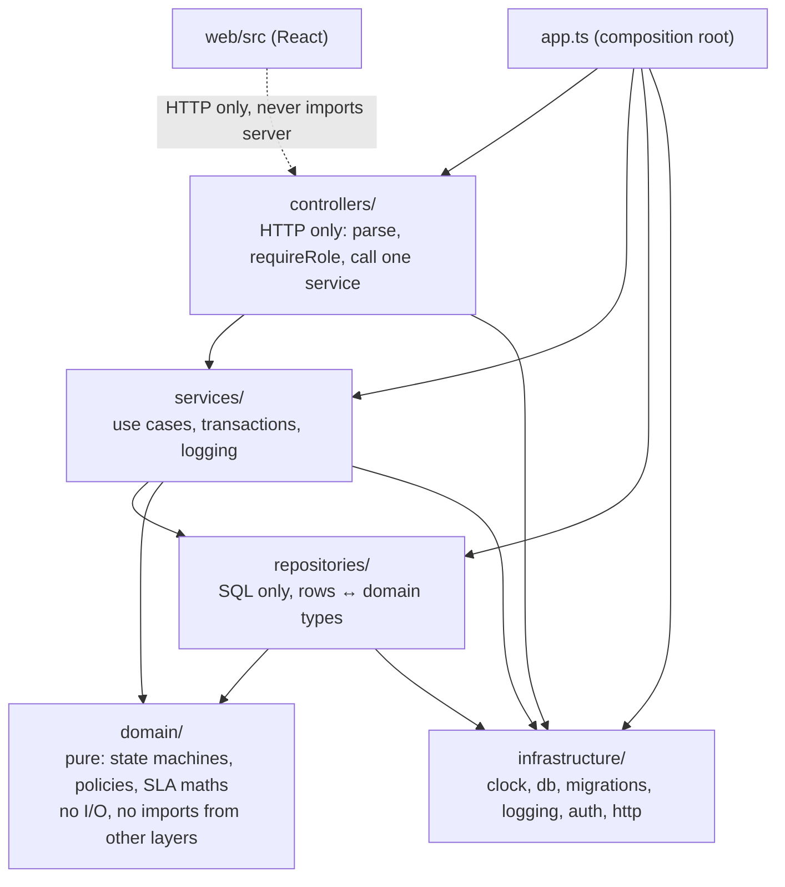
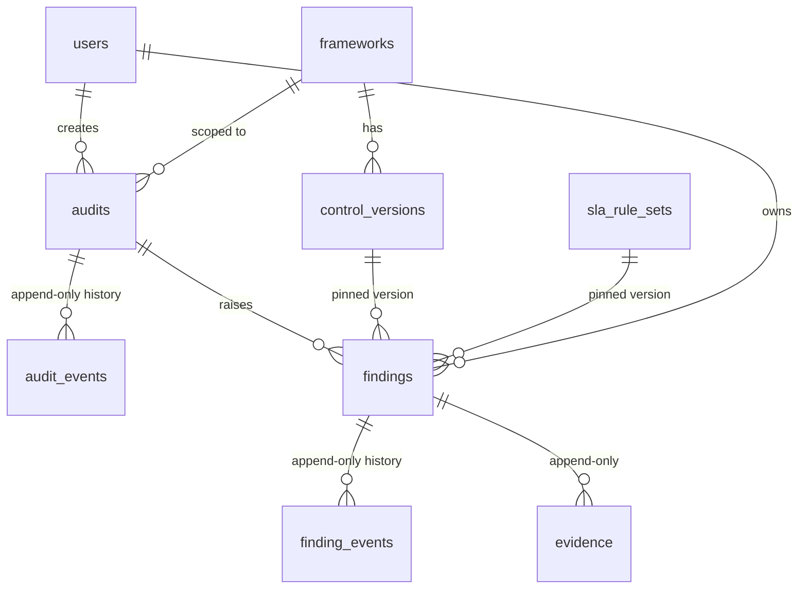
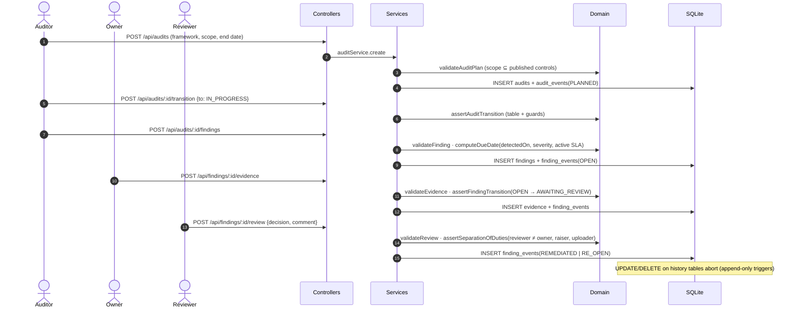

# SecureGate — architecture

SecureGate is one Node 22 process: an Express API over an embedded SQLite database (`node:sqlite`), serving a
React single-page app built by Vite. One command (`npm start`) builds the UI, migrates, seeds synthetic data and serves
everything on port 3000. There are no external services: evidence storage is a stub reference (`stub://evidence/…`).

## 1. System context (C4 level 1)

## 2. Containers (C4 level 2)

## 3. Layers (enforced by `tests/architecture` and `.dependency-cruiser.cjs`)

| Rule | Where it is enforced |
|---|---|
| `domain/` imports nothing outside `domain/` | `tests/architecture/layering.test.ts`, depcruise `domain-is-pure` |
| Controllers never touch repositories | `layering.test.ts`, depcruise `controllers-not-to-repositories` |
| Repositories never import services or controllers | depcruise `repositories-not-upward` |
| Web never imports server code | depcruise `web-not-to-server` |
| Every route declares `requireRole(...)` or `publicRoute` on the same line | `layering.test.ts`, hook `role-boundary-check.sh` |
| History tables are append-only | SQL triggers (`002`, `004`), `appendOnly.test.ts`, hooks `finding-immutability-check.sh`, `migration-append-only-check.sh` |
| Migrations never change once locked | `migrations.lock.json`, `migrations.test.ts`, `npm run migrations:lock -- --check` in CI |
| SLA maths is integer days, never `Date` arithmetic in the domain | `integerArithmetic.test.ts` |
| Remediation decisions go through `assertSeparationOfDuties` | `sodWiring.test.ts`, hook `sod-guard.sh` |
| The Claude hooks themselves block what they claim to | `hooks.test.ts` (runs each hook with real payloads) |

## 4. Data model

Current state is never stored in an updatable column: an audit's state is its latest `audit_events` row and a
finding's state is its latest `finding_events` row. Published `control_versions` rows and `sla_rule_sets` cannot be
updated or deleted (triggers raise `append-only: …`). A finding pins the control version and SLA rule-set version it
was raised under, so later edits never move a due date.

## 5. Audit-to-remediation flow

## 6. Cross-cutting concerns

- **Auth.** Demo sign-in issues an HMAC-signed token (8 h TTL) carrying only the user id. The role is read from the
  database on every request, so a role change applies immediately (AC-10). Tokens are never logged.
- **Errors.** Domain errors carry a code (`VALIDATION_FAILED`, `INVALID_FINDING_STATE`, `SOD_VIOLATION`, …) that
  `http/errors.ts` maps to 400/401/403/404/409; denials are logged as `security.denied`.
- **Logging.** One JSON object per line; `AsyncLocalStorage` adds `correlationId`, `auditId`, `findingId`; the
  masker hides tokens, emails, IPs and secrets (NFR-03, NFR-06).
- **Time.** All dates are ISO calendar days converted to integer day numbers (`domain/calendar.ts`). `Clock` is
  injected; `FIXED_NOW` pins it for demos and Playwright snapshots.
- **Seeding.** `seed/seed.ts` replays history through the real services with back-dated clocks, so seed data obeys
  every rule the API does.

## 7. Repository map

| Path | What |
|---|---|
| `server/src/domain` | Pure rules: state machines, policies, SLA, SoD, dashboard aggregation |
| `server/src/services` | Use cases; one file per bounded area |
| `server/src/repositories` | SQL access |
| `server/src/controllers` | Express routers |
| `server/src/infrastructure` | Clock, DB, migrations, logging, auth, HTTP helpers |
| `server/migrations` | Append-only SQL migrations + lock file |
| `web/src` | React UI (pages per role, shared components) |
| `tests/{unit,api,architecture,e2e}` | Vitest + Playwright suites |
| `.claude/` | Agents, skills, commands, hooks, settings |
| `specs/`, `sprint-contracts/`, `docs/` | Specs, sprint contracts, reviews, post-mortems, fix loops |
